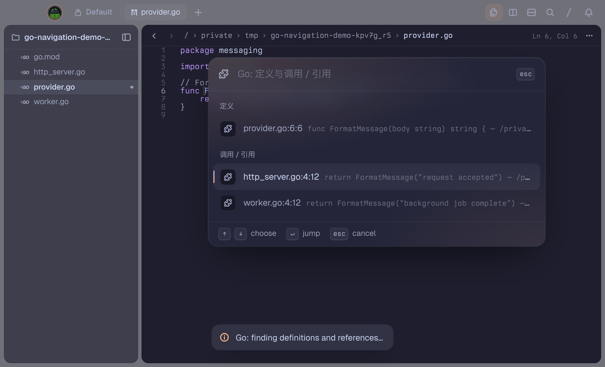
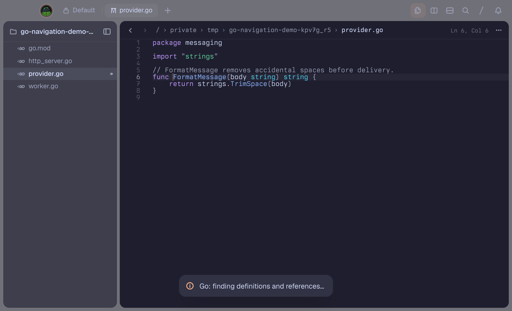
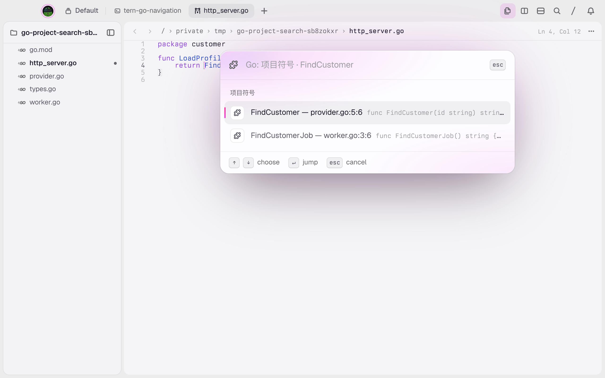

# Go Navigation — a Tern plugin

**English** | [简体中文](README.zh-CN.md)

Navigate Go code inside **Tern's native editor**. Find definitions and references together, search your project for functions and other symbols, preview the matching source line, and jump to the exact location. No replacement editor and no forced saves.







## Highlights

- **One navigation command** — definitions first, references next, in one deduplicated list.
- **Project-wide symbol search** — find functions, methods, types, and package-level variables without opening their files first. Dependencies, the standard library, and unrelated modules stay out of the results.
- **Preview before jumping** — each result shows its file, line, column, source line, and path.
- **Unsaved buffers work** — queries and previews use the current window's editor content without modifying or saving source files.
- **Prewarmed, persistent gopls** — loading starts in the background after focusing a Go file. Navigation and search share the same language server throughout the editor process's lifetime.
- **Jump back safely** — keep a per-window jump history and reject stale navigation after the cursor or captured buffers change.
- **Go workspaces and Unicode** — support `go.mod`, `go.work`, tabs, CJK characters, emoji, and combining characters.

## Install

### Requirements

- **Tern**, with the `tern` command available. Tested with `0.9.7 (c2f7563)`.
- **The Go toolchain and gopls**, even when using a prebuilt release. gopls needs Go to load and analyze your project. The examples use the tested gopls version `v0.21.1`.
- **Git and GitHub SSH access** only if installing from source.

Release packages currently target **macOS Apple Silicon (`darwin-arm64`)**. Other Unix platforms have not been validated; Windows is not supported by the current Unix-socket/process implementation.

The plugin source requires Go 1.23 or newer. Installing gopls may download a newer toolchain automatically according to gopls's requirements. Local verification used Go 1.27.3.

### Release package — prebuilt plugin backend

Download the versioned **`go-navigation-<version>-darwin-arm64.tar.gz`** and its **`.tar.gz.sha256`** checksum from [Releases](https://github.com/Evolt0/tern-go-navigation/releases). Use these named assets, not GitHub's automatically generated “Source code” archives.

If no release is available yet, use the source installation below. Release assets are created by the version-tag workflow described under [Publishing releases](#publishing-releases).

For version `1.3.0`, run these commands in the download directory:

```sh
# Still required for semantic Go navigation:
go install golang.org/x/tools/gopls@v0.21.1

shasum -a 256 -c go-navigation-1.3.0-darwin-arm64.tar.gz.sha256
tar -xzf go-navigation-1.3.0-darwin-arm64.tar.gz
tern plugin install ./go-navigation
tern plugin list
```

The archive contains a complete plugin directory, including `bin/tern-go-navigation`, both READMEs, screenshots, the changelog, and third-party license notices. `tern plugin install` copies it into Tern's plugin directory, so the extracted download can be removed afterward.

If you already have a **linked source installation**, unlink it before switching to a release package:

```sh
tern plugin unlink go-navigation
tern plugin install ./go-navigation
```

Prebuilt binaries are not notarized. If macOS blocks execution, review the system's security prompt or build from source; the plugin does not disable system security checks.

### From source

The repository is named `tern-go-navigation`, so Git already creates a local directory with that name. No extra destination-directory argument is needed. The clone URL uses SSH:

```sh
git clone git@github.com:Evolt0/tern-go-navigation.git
cd tern-go-navigation

go install golang.org/x/tools/gopls@v0.21.1
go build -o bin/tern-go-navigation .

tern plugin link "$PWD"
tern plugin list
```

Look for `go-navigation` with a `ready` status. Open a `.go` file in your project and press **Ctrl+Option+G**.

A linked installation runs directly from the checkout: **do not delete or move that directory**. Installing only the Git URL does not build the backend automatically; use the build-and-link steps above.

### Update

**Release installation:** download and verify the new release, extract it into a clean directory, then replace the installed copy:

```sh
tern plugin install ./go-navigation --force
```

`--force` does not replace a linked source installation. Unlink that installation first if switching installation methods.

**Linked source installation:** run inside the checkout:

```sh
git pull --ff-only
go build -o bin/tern-go-navigation .
tern plugin reload go-navigation
```

The next query uses the rebuilt backend; restarting Tern is not required.

### Uninstall

For a copied release installation:

```sh
tern plugin remove go-navigation
```

For a linked source installation:

```sh
tern plugin unlink go-navigation
```

Already-running editor-owned language servers are reclaimed when their owning Tern process exits, or when their backend executable is replaced or removed. Exit the relevant Tern process if you need immediate cleanup after unlinking. Standalone CLI sessions without a Tern window context still expire after five idle minutes. Your source checkout, Go installation, and gopls installation are not removed automatically.

## Keys and navigation

Place the cursor on a Go function, type, or variable for navigation:

| Key on macOS | Action | Command palette |
| --- | --- | --- |
| **Ctrl+Option+G** | Find definitions and references together | `Go: Navigate symbol` |
| **Ctrl+Option+S** | Search symbols in the current project | `Go: Search project symbols` |
| **Ctrl+Option+B** | Return to the previous jump location | `Go: Jump back` |
| **↑ / ↓** | Select a result | — |
| **Enter** | Jump to the selected result | — |
| **Esc** | Dismiss the picker | — |

Definitions precede references; duplicate locations are removed. A single navigation result opens directly. References include calls, variable reads/writes, and type uses—not only function calls.

Source previews prefer unsaved buffers. They trim leading indentation and trailing whitespace while preserving whitespace inside the code. Previews reuse source text already read by the query; they do not issue extra gopls requests or file reads. Long rows are truncated by Tern's native picker.

Jump history lives in the current window and is cleared on plugin reload. Custom keybindings can target `plugin.go-navigation.navigate`, `plugin.go-navigation.symbols`, and `plugin.go-navigation.back`. The older separate `definition` and `references` actions have been removed.

## Search functions in your project

1. Open any local `.go` file in the project. The cursor does not need to be on a function name.
2. Press **Ctrl+Option+S**, enter a name such as `FindCustomer`, and press Enter to search.
3. Inspect the symbol name, source preview, and file location, then press Enter to jump. **Ctrl+Option+B** returns to the origin.

Search uses gopls `workspace/symbol` with fuzzy matching. It includes unopened files and unsaved changes in the current window. Its scope is the current module or the modules explicitly enrolled in `go.work`, including members outside the workspace directory. Standard-library symbols, external dependencies, vendor directories, unenrolled nested modules, and symlink escapes are excluded.

Tern's native prompt submits a query on Enter; it does not query the server on every keystroke. Typing in the result picker filters the results already returned. gopls v0.21.1 returns at most 100 top-ranked symbols, so use a more specific query when needed. This is symbol search, not full-text search over comments or function bodies.

## Indexes and caching

- **Live sessions:** reuse gopls by window, workspace, and toolchain environment. A Go file triggers a background warmup attempt; short idle periods do not discard the editor's index. Queries synchronize changed files and buffers rather than rescanning the entire project.
- **Disk cache:** use gopls's own persistent package summaries, cross-reference indexes, and symbol indexes. On macOS the default location is under `~/Library/Caches/gopls`; `GOPLSCACHE` changes the cache root. A new process can reuse cached data but still needs to load workspace metadata.
- **No stale-result cache:** navigation and search ask the same continuously updated language service. Dependency-directory discovery remains necessary at initialization and after module configuration changes to preserve observation of external dependency edits.

References: [VS Code symbol navigation](https://code.visualstudio.com/docs/editing/editingevolved#open-symbol-by-name), [Zed's Go/gopls support](https://zed.dev/docs/languages/go), and [gopls persistent indexes and incremental updates](https://go.dev/blog/gopls-scalability).

## Tool discovery and troubleshooting

The backend finds gopls through `GOPLS`, then `PATH`, then `$HOME/go/bin/gopls`.

It preserves a Go executable already on `PATH`. When a GUI-launched process cannot find Go, it checks `$GOROOT/bin`, `/opt/homebrew/bin`, `/usr/local/go/bin`, and `/usr/local/bin`, adding only the selected directory to the gopls child environment. It does not modify your system environment.

- **Cannot start gopls:** check `gopls version`; expose custom locations through `GOPLS` or `PATH` inherited by Tern.
- **Go toolchain not found:** check `go version`; expose nonstandard installations through Tern's `PATH` or `GOROOT`.
- **Workspace loading fails:** the error preserves the underlying gopls explanation instead of only reporting `no views`.
- **Source changes are not reflected in the plugin:** rebuild with `go build -o bin/tern-go-navigation .`, then run `tern plugin reload go-navigation`.

## Limitations

- **No Command+click on ordinary code symbols.** Tern 0.9.7's [public routing API](https://docs.stencil.so/tern/guides/routing.html#link-requests) exposes link clicks, not ordinary-symbol clicks with document coordinates. A real desktop probe confirmed that distinction. No global mouse interception or accessibility-permission workaround is installed.
- **Previews are inline source lines**, not a separate selected-item preview pane. The native picker does not expose such a pane or a selection-change callback.
- Only local files are supported; remote-host files receive an explicit unsupported message.
- Unsaved `go.mod` and `go.work` changes are not overlays; save module configuration changes first.
- First-time loading still costs time, especially for large projects. Requests have a 45-second deadline. A query issued before warmup finishes still waits; cancellation or a language-server failure causes the affected session to be initialized again.

## Performance

These local 1.3.0 measurements compare the backend against a frozen copy of the plugin's source. Desktop measurements use a separate small Go example. They are not a guarantee for large repositories: the improvement moves loading ahead of interaction and avoids repeated cold starts, rather than claiming a faster already-warm query algorithm.

| Scenario | Time |
| --- | ---: |
| 1.2.1 first direct navigation | 1179.1 ms |
| 1.2.1 subsequent warm navigation | 6.0–6.9 ms |
| 1.3.0 background warmup | 971.5 ms |
| 1.3.0 first user navigation after warmup | 24.7 ms |
| 1.3.0 subsequent warm navigation | 6.3–7.9 ms |
| Desktop first navigation after automatic warmup | 34.8 ms |
| Desktop function-search submission to results | 54.4 ms |

## Development and verification

```sh
go test -race ./...
go build -o bin/tern-go-navigation .
tern plugin reload go-navigation
```

Integration tests require gopls and use temporary projects without network dependencies. They cover unsaved buffers, close/reopen transitions, previews, Unicode positions, immediate disk edits, external workspace modules, configuration changes, concurrent startup, atomic saves, editor lifetime, and symbol-search scope.

Real Tern desktop verification covers the combined picker, previews, jumps, history, stale-result rejection, automatic warmup, unopened-file searches, and unsaved renames. The screenshots above show the running plugin, not mockups.

`window.luau` integrates the native editor, warmup, and picker; `main.go` handles requests and positions; `daemon.go`, `session.go`, and `rpc.go` maintain language-server sessions; `symbols.go` implements scoped project search; `watch.go` synchronizes file changes.

## Publishing releases

**Yes—GitHub Actions packages and publishes releases automatically.** The workflow is [`.github/workflows/release.yml`](https://github.com/Evolt0/tern-go-navigation/blob/main/.github/workflows/release.yml).

On a pushed `vX.Y.Z` tag, it:

1. Requires the tag version to match `plugin.toml`.
2. Uses a native macOS arm64 runner, installs Go and the pinned gopls, and runs the race-enabled tests.
3. Builds a fresh plugin backend, packages the runtime files and documentation, and generates a SHA-256 checksum.
4. Extracts the package and exercises the packaged binary against a real temporary Go project.
5. Publishes the archive and checksum to GitHub Releases after those checks succeed.

Only the publishing job receives `contents: write`; it uses GitHub's built-in token, so no personal access token is required. Manual **Run workflow** executions build downloadable Actions artifacts but **do not publish a Release**. Enable Actions in the repository if it is disabled.

For the current `1.3.0` version, after committing the workflow, version, and changelog changes:

```sh
git push origin main
git tag -a v1.3.0 -m "Release v1.3.0"
git push origin v1.3.0
```

For later releases, update `plugin.toml` and the changelog first, then tag that commit with the matching version. Do not move or reuse a published tag. The workflow does not overwrite an existing Release; publish a new version for corrections.

For local packaging, maintainers need **Go and Python 3.9+**; smoke verification also needs gopls and a macOS arm64 host:

```sh
python3 scripts/package.py --output dist
python3 scripts/smoke_release.py dist/go-navigation-1.3.0-darwin-arm64.tar.gz
```

Consumers of the prebuilt package do not need Python or the plugin source. They still need Go and gopls at runtime.

## Changelog

See [Changelog](docs/reference/changelog.md) (Chinese).
